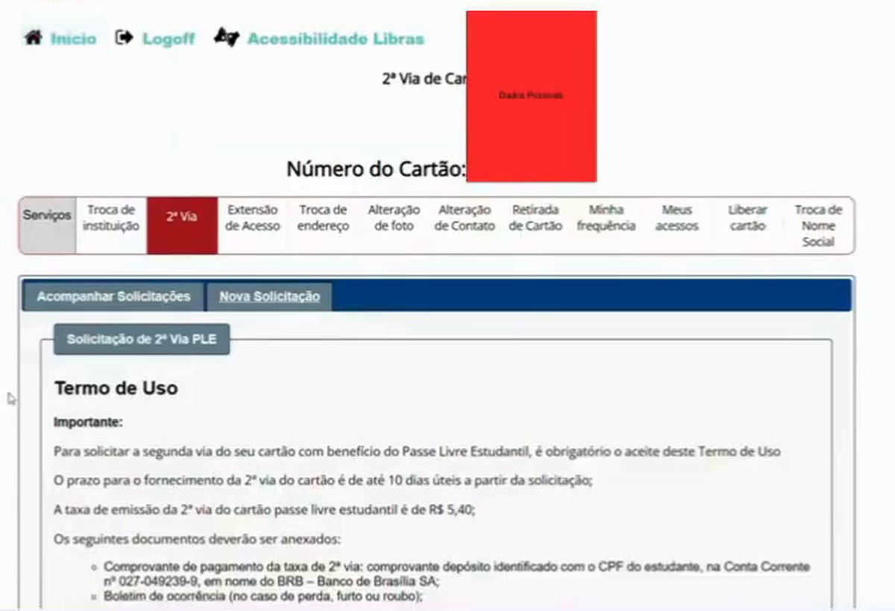
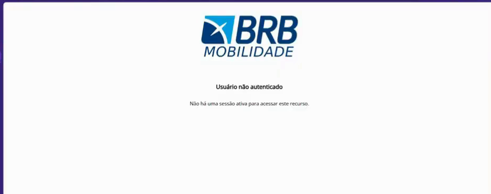

# Personas e UX

Para avaliar a experiência do usuário (UX) no BRB Mobilidade Estudantil, o grupo criou quatro personas, cada uma representando um perfil de estudante com necessidades diferentes. Cada integrante avaliou o site do ponto de vista de uma persona, como se fosse um usuário, e registrou os problemas encontrados e as soluções possíveis.

As personas são fictícias e foram construídas a partir do teste de usabilidade e da avaliação heurística do grupo. Os conceitos de persona estão na página [Personas](../guia_acessibilidade/personas.md).

| Persona | Perfil |
| :--- | :--- |
| [Persona 1: Joana](#persona-1-joana-deficiencia-visual) | Deficiência visual |
| [Persona 2: Camila](#persona-2-camila-deficiencia-auditiva) | Deficiência auditiva |
| [Persona 3: Jean](#persona-3-jean-tdah) | TDAH |
| [Persona 4: Marina](#persona-4-marina-letramento-digital-baixo-ou-intermediario) | Letramento digital baixo ou intermediário |

---

## Persona 1: Joana (deficiência visual)

  

**Joana, 32 anos**: trabalhadora e mãe sem rede de apoio, com cegueira total.

> "Quando o leitor de tela não identifica o que eu preciso, não sei o que quer dizer."

- **Hábitos tecnológicos:** utiliza leitor de tela e teclado para realizar tarefas no computador.
- **Objetivo:** fazer o acompanhamento do Passe Livre Estudantil do filho.
- **Expectativa:** botões, imagens, erros e links com descrições claras, navegação por teclado lógica e foco que retome do ponto anterior.

### UX: erros e soluções possíveis

| Funcionalidade | O que a usuária faz | Problema | Como ela se sente | Solução possível |
| :--- | :--- | :--- | :--- | :--- |
| **Recuperação de senha** | Tenta recuperar a senha sem preencher os campos | Erros invisíveis para o leitor de tela | Não sabe se o sistema travou ou se faltou algo | Usar alerta dinâmico para o leitor de tela anunciar o erro na hora |
| **Tela de login** | Insere o CPF e a senha e comete um erro | Mensagem de erro genérica | Não sabe em qual campo errou | Indicar o erro no campo específico e mover o foco para ele automaticamente |
| **Liberação de cartão** | Tenta desbloquear um cartão e busca orientação | Ícones de interrogação invisíveis para o leitor de tela | Depende de terceiros | Adicionar texto de ajuda acessível e garantir navegação por teclado |

---

## Persona 2: Camila (deficiência auditiva)

  

**Camila, 21 anos**: estudante universitária, pessoa com deficiência auditiva.

- **Hábitos tecnológicos:** utiliza Libras como meio de comunicação e usa celular e computador diariamente.
- **Objetivo:** solicitar e acompanhar o Passe Livre Estudantil com autonomia.
- **Tarefas no site:** acessar a conta, realizar solicitações, consultar documentos e acompanhar o andamento do cartão.
- **Expectativa:** informações claras, instruções fáceis de compreender e vídeos com Libras e legendas.
- **O que dificulta:** a ausência de conteúdos em Libras e de alternativas visuais para possíveis avisos sonoros.

### UX: dificuldades e soluções

| Problema | Impacto para a usuária | Solução possível |
| :--- | :--- | :--- |
| **Navegação inconsistente** | Dificuldade para localizar funções e continuar as tarefas | Manter menus e padrões de navegação consistentes |
| **Links pouco objetivos** | Dificuldade para identificar a finalidade de cada link | Utilizar nomes claros que indiquem o destino |
| **Abertura de novas páginas sem aviso** | Interrupção do fluxo de navegação ao abrir novas abas ou páginas | Avisar previamente quando uma ação abrir outra página |

---

## Persona 3: Jean (TDAH)

  

**Jean, 22 anos**: estudante universitário que utiliza o Passe Livre Estudantil e possui TDAH.

> "Quando tem muita informação na tela, acabo me perdendo e demoro para encontrar o que preciso."

- **Hábitos tecnológicos:** utiliza o celular diariamente e prefere interfaces organizadas, instruções diretas e informações simples.
- **Objetivo:** resolver questões relacionadas ao Passe Livre Estudantil de forma rápida e independente.
- **Tarefas no site:** consultar informações do cartão, solicitar a 2ª via, verificar postos de atendimento e realizar a extensão de acesso.
- **Expectativa:** encontrar informações facilmente, realizar tarefas com poucas etapas e receber orientações claras.
- **O que dificulta:** excesso de informações, textos extensos, muitas opções na mesma tela, elementos que desviam a atenção e instruções pouco objetivas.

### UX: problemas e soluções

| Problema | Impacto para o usuário | Solução possível |
| :--- | :--- | :--- |
| **Tempo de sessão limitado** | Pode interromper uma tarefa antes de sua conclusão | Avisar antes do encerramento e permitir ampliar o tempo da sessão |
| **Erros nos formulários** | Dificultam a identificação do que precisa ser corrigido | Destacar o campo com erro e apresentar instruções simples de correção |
| **Navegação inconsistente** | Dificulta a localização das funções e a continuidade das tarefas | Manter menus e padrões de navegação consistentes em todas as páginas |

---

## Persona 4: Marina (letramento digital baixo ou intermediário)

  

**Marina, 18 anos**: estudante do ensino médio, beneficiária do Passe Livre Estudantil.

> "Tenho medo de clicar errado e perder o meu benefício."

- **Hábitos tecnológicos:** usa o celular todos os dias para mensagens e redes sociais, mas tem pouca prática com sites de serviço. Lê devagar, tem medo de errar e costuma desistir quando não entende um termo ou uma mensagem.
- **Objetivo:** resolver tudo pelo site, sem depender de outra pessoa e sem ir a um posto.
- **Tarefas no site:** 2ª via do cartão, posto de atendimento, troca de instituição e extensão de acessos.
- **Expectativa:** passo a passo claro, textos curtos e avisos que digam o que fazer quando algo dá errado.
- **O que dificulta:** siglas, textos longos, muitas opções ao mesmo tempo e erros sem orientação.

### UX: problemas e soluções

Na tela de 2ª via do cartão, a Marina se sente **perdida no menu, cansada com o texto e com medo de aceitar sem entender**. Os problemas 1 a 3 aparecem nessa tela. Os problemas 4 e 5 vêm de outras telas do teste de usabilidade.

*Figura 1 – Tela de 2ª via do cartão, gravada no teste com a usuária (dados pessoais cobertos). Fonte: Grupo 06 (2026).*

| # | Problema | Como ela se sente | Solução possível |
| :---: | :--- | :--- | :--- |
| 1 | **11 serviços em abas pequenas, sem busca** | Perdida, não sabe onde clicar | Menu agrupado por assunto e campo de busca |
| 2 | **Sigla sem explicação:** o título "Solicitação de 2ª Via PLE" não diz o que é PLE | Insegura | Explicar a sigla na primeira vez que aparece |
| 3 | **Termo de Uso longo e difícil:** prazo, taxa e documentos misturados em texto corrido | Cansada, aceita sem entender tudo | Resumir em passos, com valor e prazo em destaque |
| 4 | **"Usuário não autenticado", sem botão** | Acha que o site parou de funcionar | Mensagem simples e botão "Entrar" |
| 5 | **Extensão de acesso e postos difíceis de achar** | Desanimada, não resolve só pelo site | Destacar esses serviços na tela inicial da conta |

O problema 5 também aconteceu no teste com a usuária real: ela não encontrou onde pedir a extensão de acessos e só achou os postos de atendimento fora da área do cadastro.

*Figura 2 – Mensagem "Usuário não autenticado. Não há uma sessão ativa para acessar este recurso.", sem botão para voltar (problema 4). Fonte: Grupo 06 (2026).*

---

## Referência

BARBOSA, S. D. J. *et al.* **Interação Humano-Computador e Experiência do Usuário**. Autopublicação, 2021.

Para as demais normas e materiais, acesse a página de [referências bibliográficas](../guia_acessibilidade/referencias.md).
