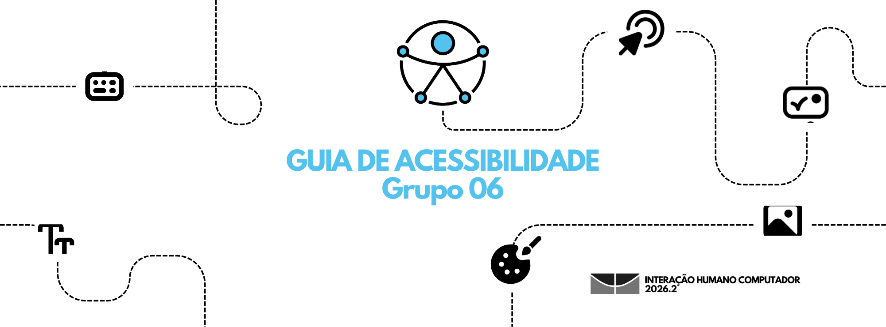
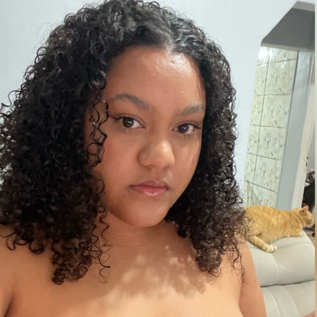
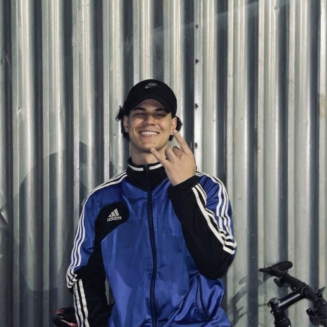
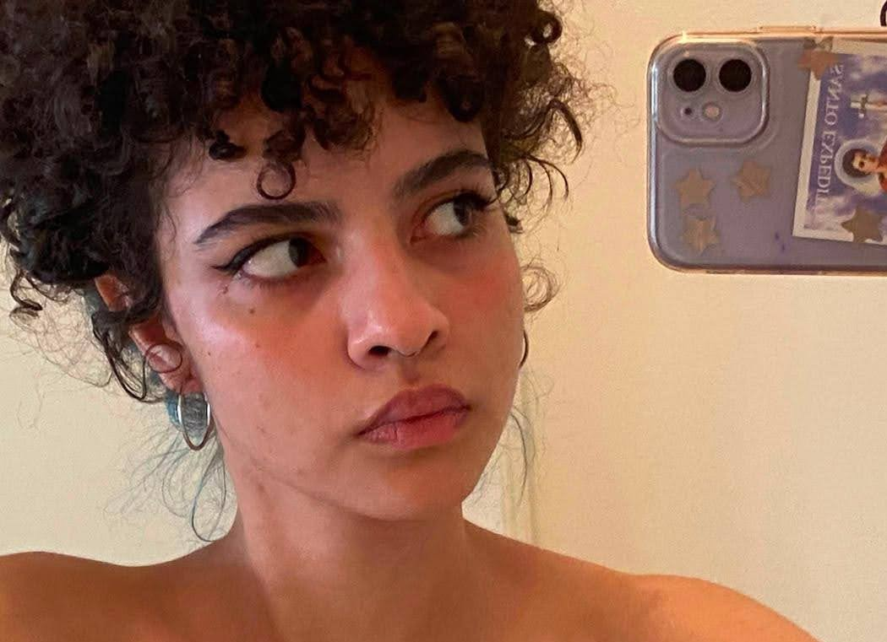

# Projeto de Interação Humano-Computador

Bem-vindo ao nossos pocket, esta página serve como ponto de partida e apresentação geral do portal. Aqui está reunida toda a estrutura e a prática de acessibilidade e usabilidade aprendidas na disciplina de Interação Humano-Computador.

---

## 🚀 Sobre o Projeto

O propósito central deste projeto é a construção de um guia de referência prático e fundamentado, desenhado para servir de instrumento metodológico na análise, avaliação e proposição de melhorias de acessibilidade, usabilidade e experiência do usuário (UX) em interfaces web. Embora o guia seja aplicado e validado neste momento na plataforma digital do BRB Mobilidade Estudantil (utilizada por estudantes do Distrito Federal para a gestão do Passe Livre Estudantil), a sua estrutura foi concebida com um escopo amplo e replicável, apta a ser utilizada na auditoria de qualquer sistema digital.

---

## 🗺️ Guia de Navegação

-   :material-wheelchair-accessibility:{ .lg .middle } __Guia de Acessibilidade__

    ---

    Consolidação dos princípios da **WCAG 2.2**, requisitos da NBR 17225:2025 e o checklist estruturado de avaliação.

    [:octicons-arrow-right-24: Ver Documentação](guia_acessibilidade/introducao/)

-   :material-web:{ .lg .middle } __O Site Avaliado__

    ---

    Apresentação e contexto da plataforma do **BRB Mobilidade Estudantil**, destacando o escopo e funcionalidades do sistema analisado.

    [:octicons-arrow-right-24: Ver Documentação](sobre_o_site/brb_mobilidade/)

---

## 👥 Integrantes do Grupo 06

-   { align=left width="100" }

    **Arthur Brayan Freire Araújo**  
    Matrícula: 241025603

-   { align=left width="100" }

    **Danielly Reis Dos Santos**  
    Matrícula: 261013753

-   { align=left width="100" }

    **Davi de Araujo Campelo**  
    Matrícula: 211062858

-   { align=left width="100" }

    **Júlia Pêgo de Meneses**  
    Matrícula: 231037745

-   { align=left width="100" }

    **Levi Evangelista Santos**  
    Matrícula: 241012042

-   { align=left width="100" }

    **Marcely do Nascimento Silva**  
    Matrícula: 241025701

-   { align=left width="100" }

    **Maria Eduarda Dos Santos Rosa**  
    Matrícula: 232023940

-   { align=left width="100" }

    **Pedro Henrique Conceição De Souza**  
    Matrícula: 232030032

---
